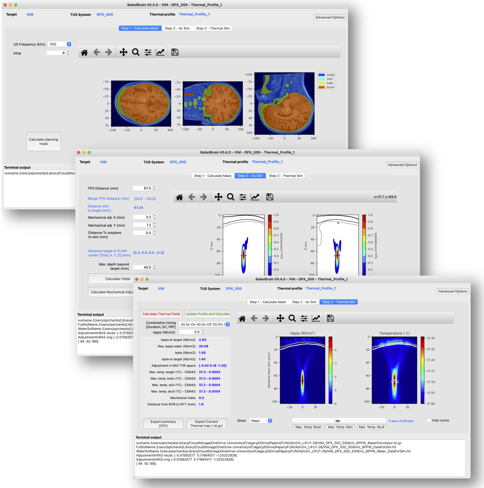
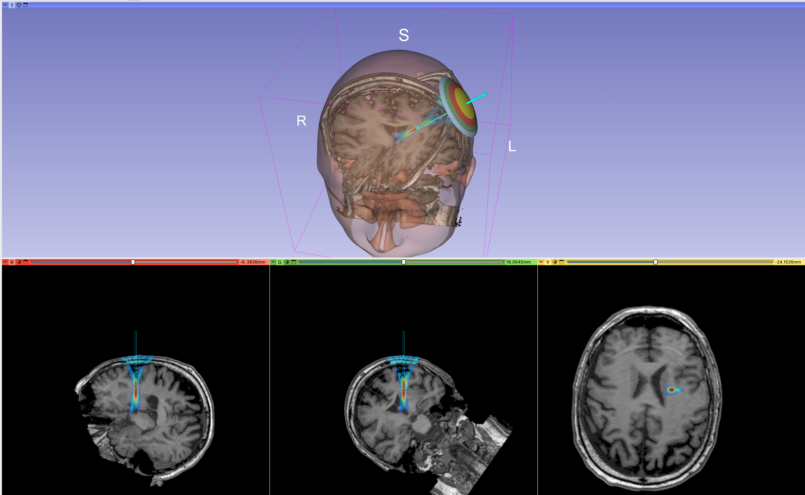

BabelBrain v0.8.8
=============
Samuel Pichardo, Ph.D  
Associate Professor  
Radiology and Clinical Neurosciences, Hotchkiss Brain Institute  
Cumming School of Medicine,  
University of Calgary   
samuel.pichardo@ucalgary.ca  
https://profiles.ucalgary.ca/samuel-pichardo 
https://www.neurofus.ca


[](LICENSE)
[](https://proteusmrighifu.github.io/BabelBrain)


**GUI application for the modeling of transcranial ultrasound for neuromodulation applications**




BabelBrain is a frontend application for research purposes only in the study of applications of transcranial focused ultrasound. BabelBrain calculates the transmitted acoustic field in the brain tissue, considering the distortion effects caused by the skull barrier. BabelBrain also calculates the thermal effects of a given ultrasound regime, which is regulated mainly by the total duration of ultrasound exposure, the duty cycle of ultrasound use, and the peak acoustic intensity,

BabelBrain is designed to work in tandem with neuronavigation and/or visualization software (such as Rogue Research's Brainsight or 3DSlicer). This tool combines image processing to prepare domains for ultrasound simulation and uses <a href="https://github.com/ProteusMRIgHIFU/BabelViscoFDTD" target="_blank">BabelViscoFDTD</a> extensively for transcranial modeling calculations. BabelViscoFDTD is a finite-difference time-difference solver of isotropic viscoelastic equation, which was implemented to support multiple GPU backends (Metal, OpenCL and CUDA).  Predictions of BabelViscoFDTD have been validated experimentally (<a href="https://pubmed.ncbi.nlm.nih.gov/28783716/" target="_blank">Pichardo et al., 2017</a>) and cross-validated with other numerical tools for ultrasound propagation (<a href="https://asa.scitation.org/doi/10.1121/10.0013426" target="_blank">Aubry et al., 2022</a>). BabelBrain supports multiple GPU backends (Metal, OpenCL and CUDA) and works in all major operating systems, with an emphasis on Apple ARM64-based systems, which are very common in brain imaging research.  

# Citation
If you find BabelBrain useful for your research, please consider adding a citation to:  
Pichardo S. BabelBrain: An Open-Source Application for Prospective Modeling of Transcranial Focused Ultrasound for Neuromodulation Applications.  
IEEE Trans Ultrason Ferroelectr Freq Control. 2023 Jul;70(7):587-599.  
doi: <a href="https://doi.org/10.1109/TUFFC.2023.3274046" target="_blank">10.1109/TUFFC.2023.3274046</a>. Epub 2023 Jun 29. PMID: 37155375.

# Disclaimer
This software is provided "as is" and it is intended exclusively for research purposes.
# Hardware requirements
* A decent GPU (AMD, Nvidia or Apple Silicon). For AMD and Nvidia GPUs, 8 GB or more is  recommended. For Apple Silicon (M1, M2, and M3 series), 16 GB RAM or more is recommended. Intel-based Mac systems need a dedicated AMD GPU (internal or external). Intel-based iMac Pro and MacPro systems have internal GPUs suitable for sub 650 kHz simulations (i.e., Vega 56, Vega 64). An external GPU (i.e., AMD W6800 Pro) offers excellent performance and capability for high-frequency simulations.
* 16 GB RAM or more for main CPU memory for Intel-based systems.

# Standalone application
Ready-to-use applications (no need for Python installation) for macOS and Windows are available in the [Releases](https://github.com/ProteusMRIgHIFU/BabelBrain/releases) section. 
* For macOS, download the correct DMG image according to your CPU architecture (Intel X64 or ARM64),  and double-click the PKG installer. The first time you use you will be prompted to authorize to run and access directories.
* For Windows, download the MSI file and run the installer.

**Note for Windows:** CUDA 11.7 or up must be installed. Visual Studio (commercial or Community version) must be also installed. Verify the version of Visual Studio is officially supported with the CUDA version. Visual Studio 2019 and 2022 Community versions works well with recent versions of CUDA.  Please ensure Visual Studio has the 'Desktop development with C++' option installed.

# Instructions for use
Please consult the [online manual](https://proteusmrighifu.github.io/BabelBrain/) for details on instructions for use.

# Manual Installation for Development 
## Cloning the repository
> **Temporary:** the submodule currently points at the fork [spichardo/PlanTUS](https://github.com/spichardo/PlanTUS) instead of upstream `mlueckel/PlanTUS`. It carries a fix to the BabelBrain trajectory export (upstream renamed the SimNIBS `000` target name with a global string replace, which also corrupted numeric values containing `000`, e.g. `0.0000`). It will move back to upstream once that fix is merged there. If you cloned before this change, run `git submodule sync --recursive` to pick up the new URL.

BabelBrain bundles the external [PlanTUS](https://github.com/mlueckel/PlanTUS) tool as a git submodule pinned to a known-good commit (`BabelBrain/ExternalBin/PlanTUS/PlanTUS`). Clone with submodules so PlanTUS is fetched automatically:

```bash
git clone --recurse-submodules https://github.com/ProteusMRIgHIFU/BabelBrain.git
```

If you already cloned without `--recurse-submodules`, populate it with:

```bash
git submodule update --init --recursive
```

If you obtained BabelBrain as a zip/archive (no git submodule), or want to (re)pin PlanTUS, run:

```bash
python Scripts/fetch_plantus.py          # fetch PlanTUS at the pinned commit
python Scripts/fetch_plantus.py --check  # report status without changing anything
```

By default BabelBrain uses this built-in, pinned PlanTUS; the PlanTUS root field in the Advanced Options dialog is left empty. You may point that field at your own PlanTUS checkout to use a different version, at your own risk.

## Updating the PlanTUS pin
The PlanTUS version is pinned in two places that must stay in sync: the submodule **gitlink** (used by `--recurse-submodules` clones) and `PLANTUS_PIN` in `Scripts/fetch_plantus.py` (used by zip/standalone installs). The repository the pin is fetched from is likewise recorded twice — `url` in `.gitmodules` and `PLANTUS_URL` in `Scripts/fetch_plantus.py` — so switching between upstream and a fork means changing both, then running `git submodule sync --recursive` so existing checkouts follow the new URL. To move the pin to a new commit or tag (`NEWSHA` below — use the full 40-char SHA; get it from a tag with `git rev-parse <tag>^{commit}`):

```bash
cd BabelBrain/ExternalBin/PlanTUS/PlanTUS
git fetch origin
git checkout NEWSHA                                   # a commit SHA or a tag
cd -
git add BabelBrain/ExternalBin/PlanTUS/PlanTUS        # moves the gitlink
# edit Scripts/fetch_plantus.py: set PLANTUS_PIN = "NEWSHA"
git add Scripts/fetch_plantus.py
git commit -m "Bump PlanTUS pin to NEWSHA"
```

Before committing, confirm both sides agree:

```bash
git submodule status                     # gitlink SHA
grep PLANTUS_PIN Scripts/fetch_plantus.py
python Scripts/fetch_plantus.py --check  # passes only if they match
```

Also review PlanTUS's changes between the old and new commit (`git -C BabelBrain/ExternalBin/PlanTUS/PlanTUS diff --stat OLDSHA NEWSHA`) in case the `PlanTUS_wrapper.py` call in `BabelBrain/PlanTUSViewer/RunPlanTUS.py` needs matching updates. After pulling a bump, teammates must run `git submodule sync --recursive && git submodule update --init --recursive` to move their local checkout to the new URL and commit.

## Recommended settings
* All OS: create a conda environment using the appropriate yaml file for macOS Intel, macOS ARM64, Windows or Linux. 

Besides the recommended conda environment, a healthy XCode installation in macOS, or CUDA (up to v11.8) + Visual Studio/gcc in Windows/Linux will be required. Consult [BabelViscoFDTD](https://github.com/ProteusMRIgHIFU/BabelViscoFDTD) for details on what is needed for the FDTD solvers


## Running
If running from the GitHub source code, just change to the BabelBrain directory and execute

`python BabelBrain.py`Building a standalone application
A Pyinstaller specification file is ready for use. To build either the macOS or Windows application, just change to the BabelBrain directory and run

`pyinstaller BabelBrain.spec --noconfirm`

A new application ready to use will be created at `BabelBrain/BabelBrain/dist/`

# Version log
The full list of changes in each release is in [ReleasesNotes.md](ReleasesNotes.md).
