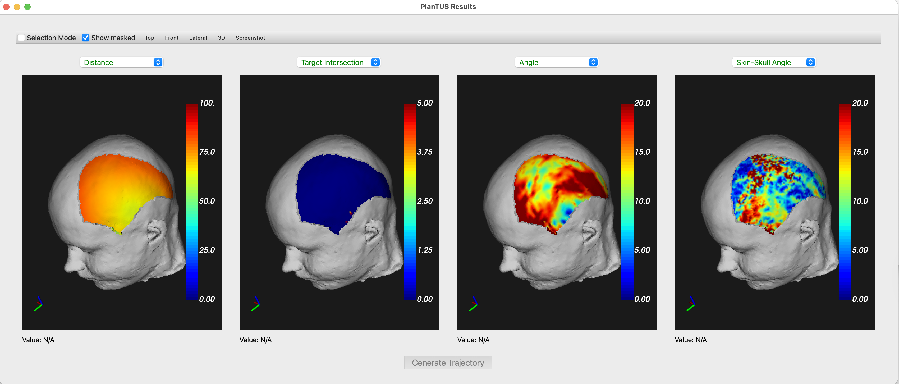
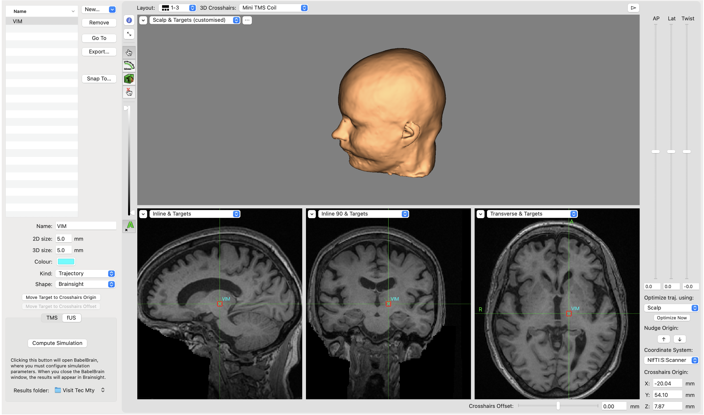
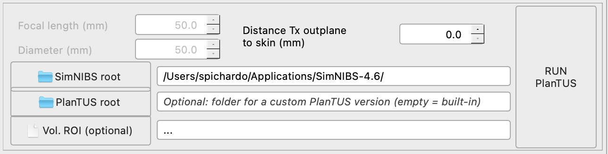
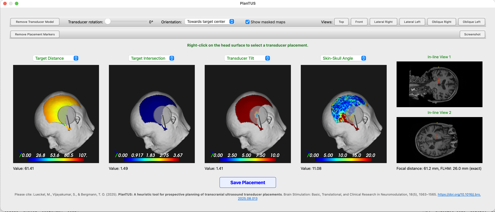
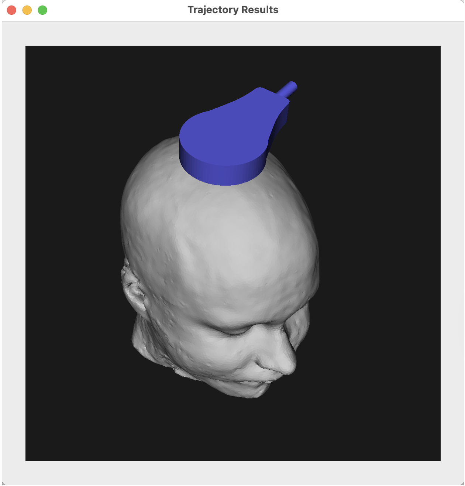
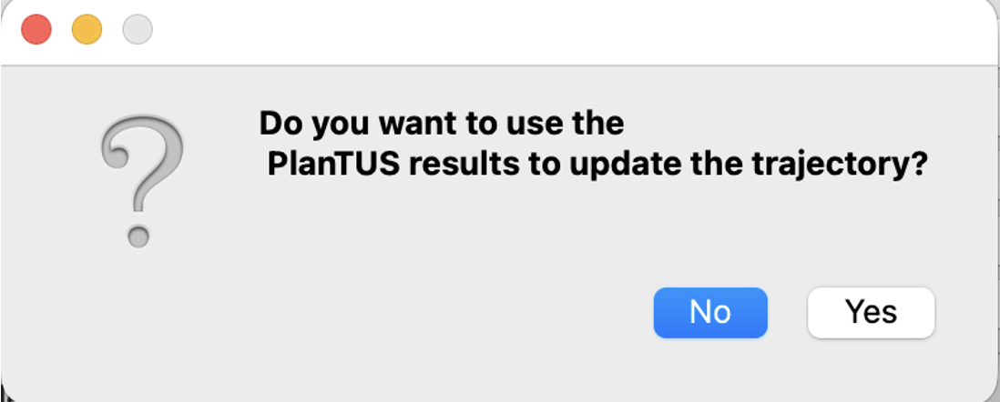
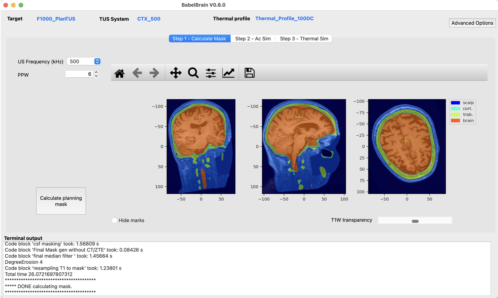

PlanTUS integration 
-----
BabelBrain integrates with the excellent tool [PlanTUS](https://doi.org/10.1016/j.brs.2025.08.013) developed by Maximilian Lueckel, Suhas Vijayakumar and Til Ole Bergmann from Mainz University that helps to refine trajectories using heatmaps of incident angles, distance, degree of intersection and skin-skull angle.

This procedure in BabelBrain can update the trajectory defined originally in 3DSlicer or Brainsight to improve, for example, incident angle. 

PlanTUS works the best when a volume mask of a target ROI is provided as input. If no ROI is provided, a 3 mm diameter ROI will be generated at the original target generated in Brainsight or 3DSlicer.

Since version v0.8.8, a complete copy of the PlanTUS code is shipped with BabelBrain. If a user decides to use an updated version of PlanTUS, they can specied in the advanced dialog PlanTUS section.

# Requirements
* Identify location path of SimNIBS - for example `/Users/spichardo/Applications/SimNIBS-4.6`
* Add extra dependencies to SimNIBS enviroment - consult PlanTUS [main page](https://github.com/mlueckel/PlanTUS) for details.

## Execution of PlanTUS
* Ideally, have an ROI mask of your region of interest in the same space of the T1w file used for simulations. If no ROI is provided, a 3 mm diameter ROI will be generated at the original target generated in Brainsight or 3DSlicer.
* Define location in Brainsight/Slicer and export trajectory/linear transformation. Do not worry to adjust the trajectory manually as is usually done, as we expect to use the one calculated with PlanTUS. Just focus on the **target location**. 

* Specify paths to tools in the Advanced Dialog

* These paths will remain saved between BabelBrain sessions.

* Click on `RUN PlanTUS` button. Execution will take only a couple of minutes. If all paths are correctly set, a multiple view window will show different heatmaps as below:

* All views are linked to inspect all heatmaps simultaneously.

* Use right click action on mouse/trackpad and select a feasible location on the head’s surface. For example, one that minimizes incident angle.
* Click on `Save Placement` and confirm to use this location for BabelBrain.

* A visualization of the transducer at the selected location will be shown

* When closing this window, a prompt will appear asking to update the target definition

* When running Step 1 in BabelBrain, you will see the new trajectory is the one selected with PlanTUS. 

* This trajectory will be saved in the same directory as the original with the “_PlanTUS” suffix added in the filename

