# Custom Transducers

BabelBrain can load your own transducer designs alongside its built-in devices. You describe the transducer in a YAML file then BabelBrain:

- Validates file
- Generates necessary transducer files
- Runs a Rayleigh simulation in water so you can check the geometry and the beam before using it.

## Workflow

1. In the file-selection dialog, choose the **computing engine** (local GPU or remote server). It is used for the Rayleigh simulations during creation.
   
2. In the **Transducer** drop-down, choose `➕ Add / remove custom transducer…`
    &emsp;&emsp;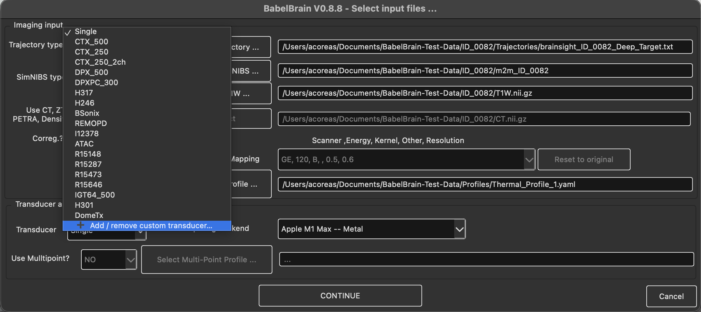
3. The **Manage Custom Transducers** dialog lists the custom transducers already installed. From here you can:

    - **Add…** a new transducer (next step).
    - **Remove** the selected transducer. After confirmation its folder is deleted.
    - **Move up** / **Move down** to change the order in which custom transducers appear in the drop-down

    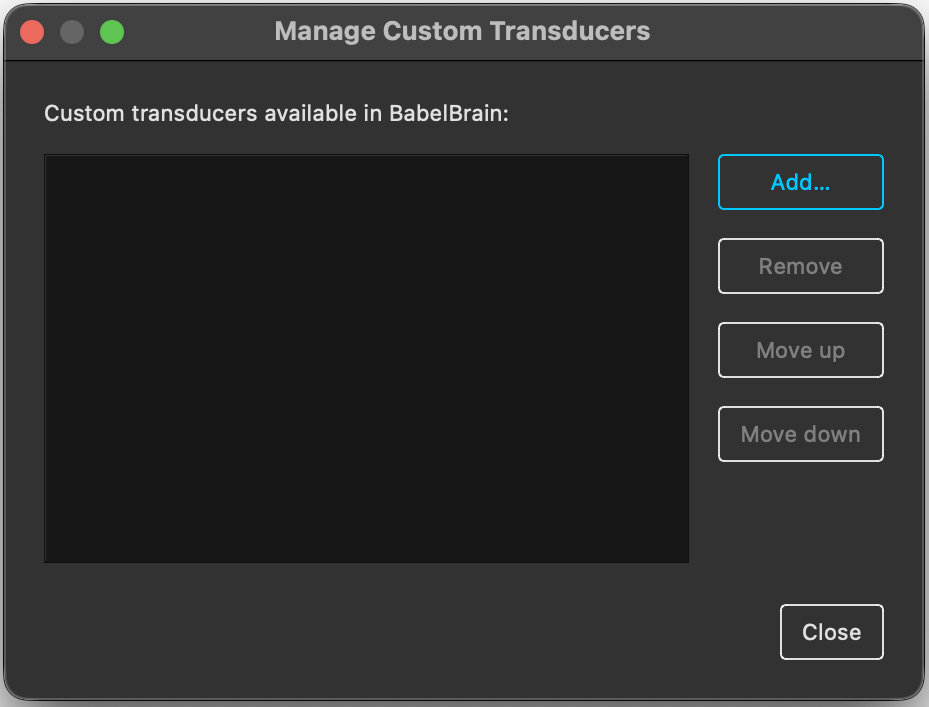

4. In the **Add Custom Transducer** dialog, click **Select Config file**, choose your YAML file and click **Create Transducer**.
   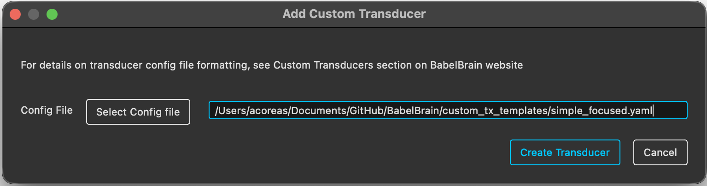
5. BabelBrain validates the file:
    - If there is a problem, an error dialog shows the offending YAML line and the reason. After you close it, the **Add Custom Transducer** dialog reopens with the same file selected, so you can fix the file and click **Create Transducer** again.
    - If a custom transducer with the same `<ClassName>` already exists, you are asked whether to overwrite it.
6. If the file has no `PlanTUS` tables, BabelBrain estimates them with Rayleigh simulations (see [PlanTUS parameters](#plantus)). This can take a while for transducers with many frequencies or a wide steering range.
   
7. The verification window shows the transducer geometry (with the focal spot and the out-plane marked) next to the simulated water field. Click **Continue** to keep the transducer, or **Cancel** to discard it. If you were overwriting an existing transducer, cancelling restores the previous version.
   
    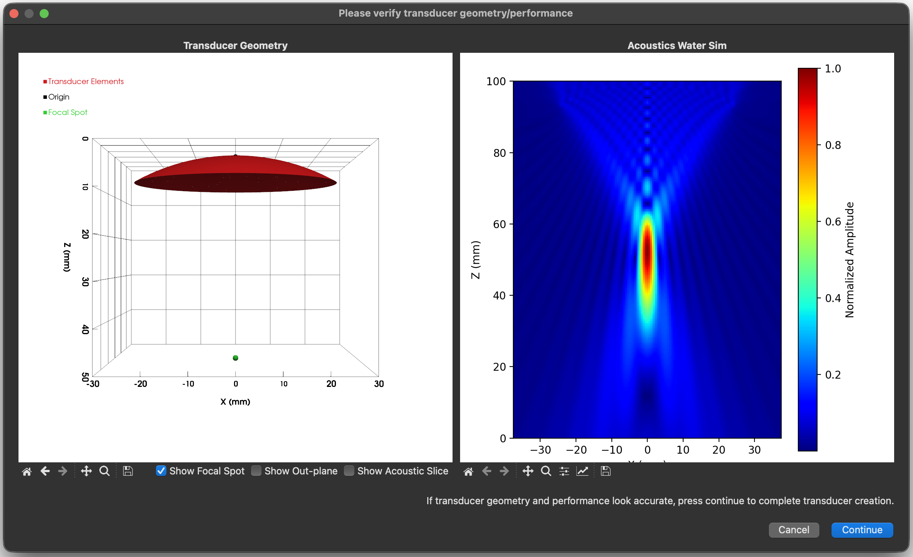
   

The transducer then appears in the drop-down as `Custom: <ClassName>`, where `<ClassName>` is the PascalCase form of `name` (e.g. `my-tx_500` → `MyTx500`). Its generated files are saved in `~/.config/BabelBrain/Transducers/babel_<ClassName>/`. Do not edit these files by hand; change the YAML file and add the transducer again instead.

## Units and conventions

<table style="width:100%">
  <colgroup><col style="width:60%"><col style="width:40%"></colgroup>
  <thead>
    <tr><th>Quantity</th><th>Unit</th></tr>
  </thead>
  <tbody>
    <tr><td>Lengths, diameters, positions, steering limits, PlanTUS distances</td><td><strong>metres</strong> (m)</td></tr>
    <tr><td>Frequencies</td><td><strong>hertz</strong> (Hz)</td></tr>
    <tr><td>Spherical angles (<code>theta</code>, <code>phi</code>)</td><td><strong>degrees</strong></td></tr>
  </tbody>
</table>

PyYAML only reads scientific notation as a number if it has a decimal point **and** a signed exponent. Anything else is read as text and fails validation:

<table style="width:100%">
  <colgroup><col style="width:50%"><col style="width:50%"></colgroup>
  <thead>
    <tr><th>You write</th><th>PyYAML reads</th></tr>
  </thead>
  <tbody>
    <tr><td style="white-space:nowrap"><code>64.0e-3</code></td><td><code>0.064</code> ✅</td></tr>
    <tr><td style="white-space:nowrap"><code>5.0e+5</code></td><td><code>500000.0</code> ✅</td></tr>
    <tr><td style="white-space:nowrap"><code>64e-3</code></td><td><code>"64e-3"</code> (text) ❌</td></tr>
    <tr><td style="white-space:nowrap"><code>500.0e3</code></td><td><code>"500.0e3"</code> (text) ❌</td></tr>
  </tbody>
</table>

Plain decimals (`0.064`, `500000.0`) are safest.

## Templates

Ready-to-edit templates are available in [`custom_tx_templates/`](https://github.com/ProteusMRIgHIFU/BabelBrain/tree/main/custom_tx_templates). Each is a valid file that reproduces a built-in device, with every parameter explained inline. Copy one, rename the transducer and replace the values.

<table style="width:100%">
  <colgroup><col style="width:30%"><col style="width:40%"><col style="width:12%"><col style="width:18%"></colgroup>
  <thead>
    <tr><th><code>geometry_type</code> / template</th><th>Description</th><th>Steering</th><th>Reproduces</th></tr>
  </thead>
  <tbody>
    <tr><td style="white-space:nowrap"><a href="#simple-focused"><code>simple_focused</code></a></td><td>Single-element spherical cap</td><td>none</td><td>Single (500 kHz)</td></tr>
    <tr><td style="white-space:nowrap"><a href="#flat-annular-array"><code>flat_annular_array</code></a></td><td>Concentric flat rings</td><td>z</td><td>H246</td></tr>
    <tr><td style="white-space:nowrap"><a href="#focused-annular-array"><code>focused_annular_array</code></a></td><td>Concentric rings on a spherical cap</td><td>z</td><td>CTX500</td></tr>
    <tr><td style="white-space:nowrap"><a href="#flat-array-2d"><code>flat_array_2D</code></a></td><td>Square elements in a flat plane</td><td>x, y, z</td><td>REMOPD</td></tr>
    <tr><td style="white-space:nowrap"><a href="#focused-array"><code>focused_array</code></a></td><td>Circular elements on a spherical cap, aimed at the focus</td><td>x, y, z</td><td>H317</td></tr>
  </tbody>
</table>

Every file must contain a `Template Version: <number>` line (e.g. `# Template Version: 1.0`).

## Common parameters
<table style="width:100%">
  <colgroup><col style="width:32%"><col style="width:16%"><col style="width:52%"></colgroup>
  <thead>
    <tr><th>Parameter</th><th>Required</th><th>Description</th></tr>
  </thead>
  <tbody>
    <tr><td style="white-space:nowrap"><code>name</code></td><td>yes</td><td>Starts with a letter; letters, digits, <code>_</code> and <code>-</code> only (no spaces). Its <code>&lt;ClassName&gt;</code> cannot match a built-in transducer.</td></tr>
    <tr><td style="white-space:nowrap"><code>geometry_type</code></td><td>yes</td><td>One of the five types above.</td></tr>
    <tr><td style="white-space:nowrap"><code>frequencies</code></td><td>yes</td><td>List of whole numbers (Hz), 200–1000 kHz in 5 kHz steps, no duplicates. The first is used for the verification simulation.</td></tr>
    <tr><td style="white-space:nowrap"><code>aperture_size</code></td><td>yes</td><td>Aperture diameter, or full width of the active surface for arrays (m).</td></tr>
    <tr><td style="white-space:nowrap"><code>focal_length</code></td><td>focused types</td><td>Radius of curvature (m). Not used by flat types, which have no natural focus.</td></tr>
    <tr><td style="white-space:nowrap"><code>distance_tx_bottom_to_outplane</code></td><td>no (default <code>0</code>)</td><td>Fabrication dead space (m) between the rim of the transducer surface and the edge of the device (the out-plane), e.g. housing or coupling membrane. Must be ≥ 0. Not applied for <code>simple_focused</code> transducers</td></tr>
    <tr><td style="white-space:nowrap"><code>distance_outplane_to_focus</code></td><td>no, focused types only</td><td>Distance (m) from the out-plane to the focal spot. Not allowed for flat types.</td></tr>
    <tr><td style="white-space:nowrap"><code>mechanical_adjustment</code></td><td>no</td><td>Lateral X/Y mechanical adjustment limits <code>[min, max]</code> (m) in Step 2. Defaults to <code>[-0.010, 0.010]</code>.</td></tr>
    <tr><td style="white-space:nowrap"><code>PlanTUS</code></td><td>no</td><td>See <a href="#plantus">PlanTUS parameters</a>.</td></tr>
  </tbody>
</table>

## Type-specific parameters

### Simple Focused

No extra parameters. There is no electronic steering, and the focal length and diameter shown in Step 2 are fixed to the values in the file.

Dead space is not supported for this type: Step 2 always places the out-plane at the rim, so its out-plane distance is `focal_length − h`. Leave `distance_tx_bottom_to_outplane` and `distance_outplane_to_focus` out of the file.

Transducer Diagram:
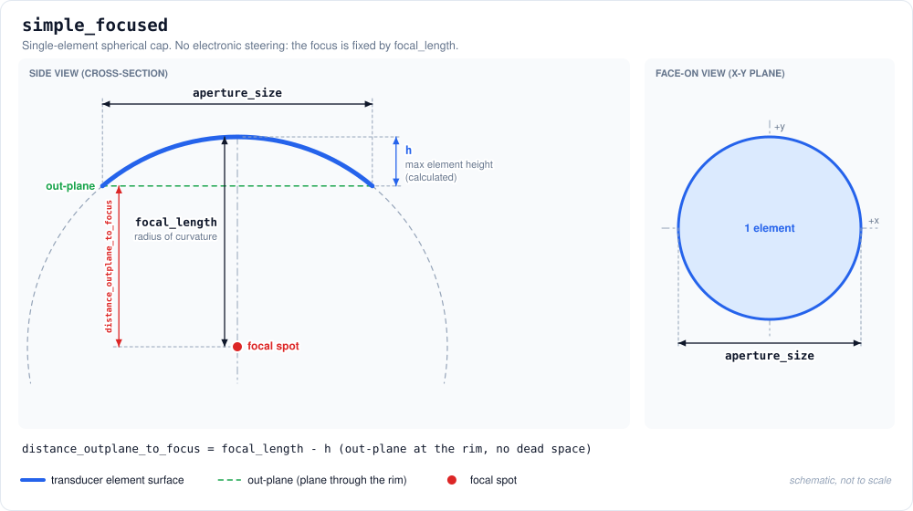

Example Transducer Yaml:
```yaml
# Template Version: 1.0
name: MySingleTx
geometry_type: simple_focused
frequencies:
    - 500000
aperture_size: 0.050
focal_length: 0.050
```


<br>Corresponding Plot:<br>
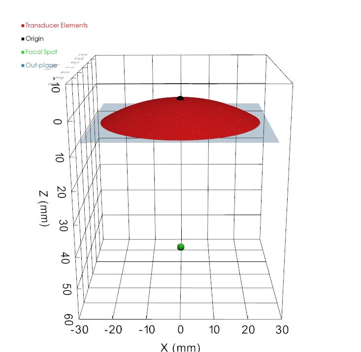
<!-- PLACEHOLDER: screenshot of the "simple focused generated mesh plot" dialog -->

### Flat Annular Array
<table style="width:100%">
  <colgroup><col style="width:35%"><col style="width:65%"></colgroup>
  <thead>
    <tr><th>Parameter</th><th>Description</th></tr>
  </thead>
  <tbody>
    <tr><td style="white-space:nowrap"><code>num_elements</code></td><td>Number of rings.</td></tr>
    <tr><td style="white-space:nowrap"><code>annular.inner_ring_diameters</code></td><td>Inner diameter of each ring (m), innermost first. <code>0.0</code> for a solid central disc.</td></tr>
    <tr><td style="white-space:nowrap"><code>annular.outer_ring_diameters</code></td><td>Outer diameter of each ring (m); each larger than its inner diameter.</td></tr>
    <tr><td style="white-space:nowrap"><code>steering.z</code></td><td>Focal depths <code>[min, max]</code> (m) measured from the array plane, <code>min</code> &gt; 0. Also the TPO distance range in the GUI.</td></tr>
  </tbody>
</table>

- There is no natural focus: `focal_length` and `distance_outplane_to_focus` are not used. The verification simulation focuses at the middle of `steering.z`.
- Automatic PlanTUS estimation is not available for this type; enter the `PlanTUS` tables yourself to use PlanTUS.

Transducer Diagram:
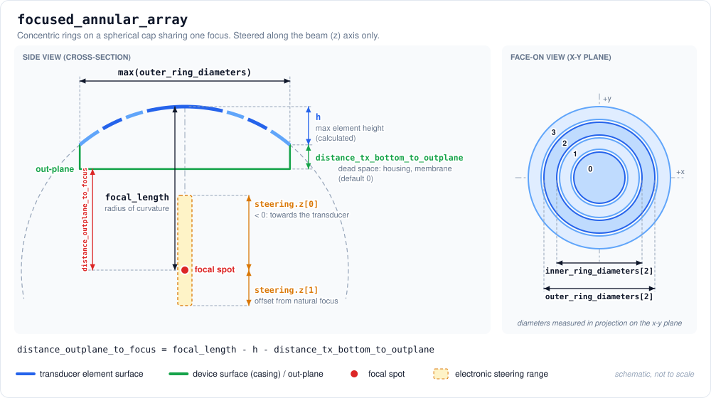

Example Transducer Yaml:
```yaml
# Template Version: 1.0
name: MyFlatAnnular
geometry_type: flat_annular_array
frequencies:
    - 500000
aperture_size: 0.0336
num_elements: 2
annular:
    inner_ring_diameters: [0.0,     0.0240]
    outer_ring_diameters: [0.0233,  0.0336]
steering:
    z: [0.025, 0.095]
```


<br>Corresponding Plot:<br>
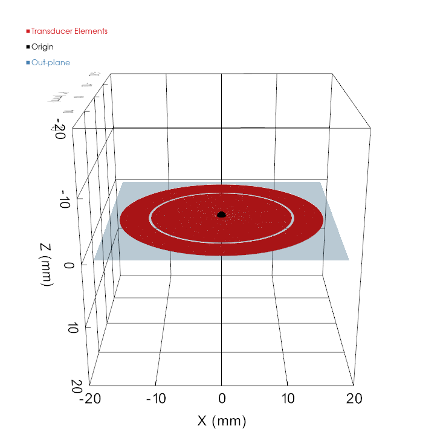
<!-- PLACEHOLDER: screenshot of the "flat annular array generated mesh plot" dialog -->

### Focused Annular Array
<table style="width:100%">
  <colgroup><col style="width:35%"><col style="width:65%"></colgroup>
  <thead>
    <tr><th>Parameter</th><th>Description</th></tr>
  </thead>
  <tbody>
    <tr><td style="white-space:nowrap"><code>num_elements</code></td><td>Number of rings.</td></tr>
    <tr><td style="white-space:nowrap"><code>annular.inner_ring_diameters</code></td><td>Inner diameter of each ring (m), innermost first. <code>0.0</code> for a solid central disc.</td></tr>
    <tr><td style="white-space:nowrap"><code>annular.outer_ring_diameters</code></td><td>Outer diameter of each ring (m); each larger than its inner diameter.</td></tr>
    <tr><td style="white-space:nowrap"><code>steering.z</code></td><td>Focal depths <code>[min, max]</code> (m) measured from the array plane, <code>min</code> &gt; 0. Also the TPO distance range in the GUI.</td></tr>
  </tbody>
</table>

Same parameters as `flat_annular_array`, with two differences:

- Ring diameters are measured **in projection onto the x-y plane**, not along the curved surface. `focal_length` must be ≥ half the largest outer diameter.
- `steering.z` is an offset from the natural focus; negative moves towards the transducer and `abs(min)` ≤ `focal_length`. The GUI's TPO range is `focal_length + steering.z` (30–82.5 mm below).

Transducer Diagram:


Example Transducer Yaml:
```yaml
# Template Version: 1.0
name: MyFocusedAnnular
geometry_type: focused_annular_array
frequencies:
    - 500000
    - 545000
aperture_size: 0.064
focal_length: 0.06294
distance_outplane_to_focus: 0.05238
num_elements: 4
annular:
    inner_ring_diameters: [0.0,     0.0316988, 0.0442688, 0.0536688]
    outer_ring_diameters: [0.03114, 0.04371,   0.05311,   0.06083]
steering:
    z: [-0.03294, 0.01956]
```


<br>Corresponding Plot:<br>
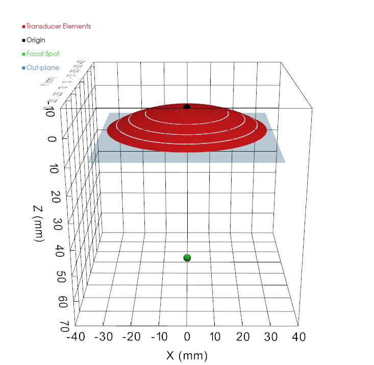
<!-- PLACEHOLDER: screenshot of the "focused annular array generated mesh plot" dialog -->

### Flat Array 2D
<table style="width:100%">
  <colgroup><col style="width:35%"><col style="width:65%"></colgroup>
  <thead>
    <tr><th>Parameter</th><th>Description</th></tr>
  </thead>
  <tbody>
    <tr><td style="white-space:nowrap"><code>num_elements</code></td><td>Number of elements.</td></tr>
    <tr><td style="white-space:nowrap"><code>element_size</code></td><td>Side length of each square element (m). Centres must be at least this far apart.</td></tr>
    <tr><td style="white-space:nowrap"><code>elements.x</code>, <code>.y</code></td><td>Element centre positions (m) in the array plane, <code>num_elements</code> entries each. <code>elements.z</code> is not accepted: all elements lie at z = 0.</td></tr>
    <tr><td style="white-space:nowrap"><code>steering.x</code>, <code>steering.y</code></td><td>Lateral steering ranges <code>[min, max]</code> (m).</td></tr>
    <tr><td style="white-space:nowrap"><code>steering.z</code></td><td>Focal depths <code>[min, max]</code> (m) measured from the array plane, <code>min</code> &gt; 0.</td></tr>
  </tbody>
</table>

- **Origin:** the centre of the array, in the plane of the element faces.
- `distance_tx_bottom_to_outplane` is applied automatically to move the out-plane away from the element plane.
- There is no natural focus: `focal_length` and `distance_outplane_to_focus` are not used. The verification simulation focuses at the middle of `steering.z`.
- Keep the pitch close to one wavelength (3 mm at 500 kHz) to avoid grating lobes. The 4 × 4 example below only shows the format.

Transducer Diagram:
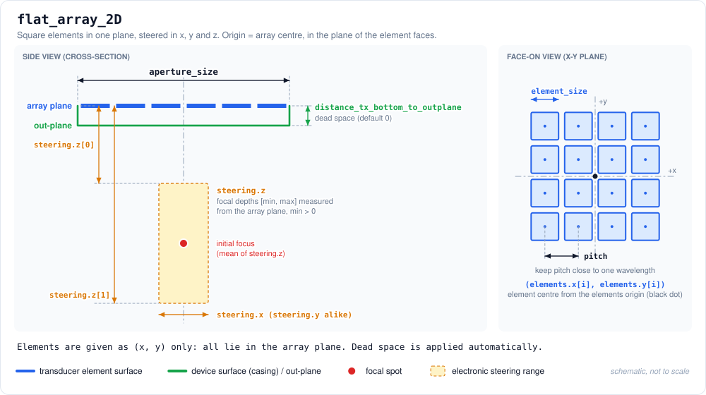

Example Transducer Yaml:
```yaml
# Template Version: 1.0
name: MyFlatMatrix
geometry_type: flat_array_2D
frequencies:
    - 500000
aperture_size: 0.040
distance_tx_bottom_to_outplane: 0.0012
num_elements: 16
element_size: 0.0095
elements:   # 4 x 4 grid, 10 mm pitch, centred on the origin
    x: [-0.015, -0.005, 0.005, 0.015, -0.015, -0.005, 0.005, 0.015, -0.015, -0.005, 0.005, 0.015, -0.015, -0.005, 0.005, 0.015]
    y: [-0.015, -0.015, -0.015, -0.015, -0.005, -0.005, -0.005, -0.005, 0.005, 0.005, 0.005, 0.005, 0.015, 0.015, 0.015, 0.015]steering:
    x: [-0.020, 0.020]
    y: [-0.020, 0.020]
    z: [0.020, 0.090]
```


<br>Corresponding Plot:<br>
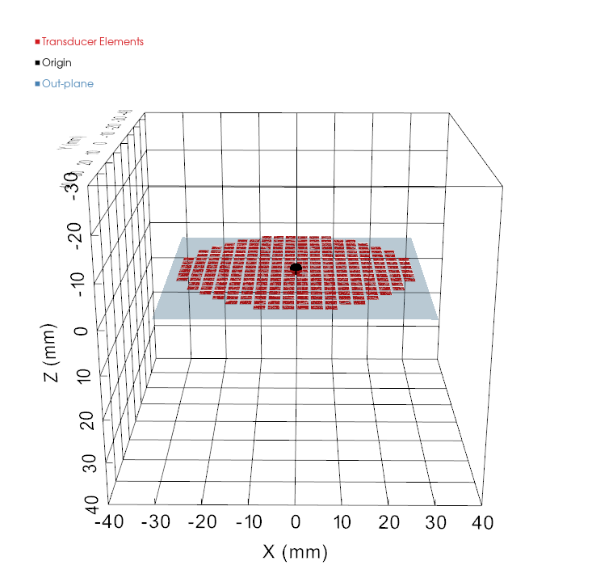
<!-- PLACEHOLDER: screenshot of the "flat 2D array generated mesh plot" dialog -->

### Focused Array
<table style="width:100%">
  <colgroup><col style="width:35%"><col style="width:65%"></colgroup>
  <thead>
    <tr><th>Parameter</th><th>Description</th></tr>
  </thead>
  <tbody>
    <tr><td style="white-space:nowrap"><code>num_elements</code></td><td>Number of elements.</td></tr>
    <tr><td style="white-space:nowrap"><code>element_size</code></td><td>Diameter of each circular element (m). Centres must be at least <code>element_size / focal_length</code> radians apart.</td></tr>
    <tr><td style="white-space:nowrap"><code>element_coordinate_system</code></td><td><code>cartesian</code> or <code>spherical</code>.</td></tr>
    <tr><td style="white-space:nowrap"><code>elements.x</code>, <code>.y</code>, <code>.z</code></td><td>Cartesian element centres (m) relative to the focus.</td></tr>
    <tr><td style="white-space:nowrap"><code>elements.r</code>, <code>.theta</code>, <code>.phi</code></td><td>Spherical element centres: radius (m), polar angle (deg), azimuth (deg).</td></tr>
    <tr><td style="white-space:nowrap"><code>steering.x</code>, <code>.y</code>, <code>.z</code></td><td>Steering ranges <code>[min, max]</code> (m). <code>z</code> is an offset from the natural focus, <code>abs(min)</code> ≤ <code>focal_length</code>.</td></tr>
  </tbody>
</table>

- **Origin:** the geometric focus. Elements lie on a sphere of radius `focal_length` and face the focus; the bowl apex is at `(0, 0, focal_length)`, so element `z` values are **positive**.
- **Steering uses a different frame:** `steering.x`, `.y`, `.z` are offsets from the natural focus with +z pointing from the transducer **towards the target**, the opposite of the element +z. A negative `steering.z` moves the focus towards the transducer, as for `focused_annular_array`.
- **Cartesian:** `x² + y² + z² = focal_length²`.
- **Spherical:** `theta` is the polar angle from the beam axis (0° = apex, increasing towards the rim); `phi` is the azimuth from +x towards +y. `x = r·sin(theta)·cos(phi)`, `y = r·sin(theta)·sin(phi)`, `z = r·cos(theta)`.
- Only the **direction** of each position is used to place the element; its distance from the focus (including `r`) is not checked. Positions in mm or from the wrong origin give a wrong layout without an error, so check the verification window.
- `distance_outplane_to_focus` is the default **Distance Cone to Focus** in Step 2.

Transducer Diagram:
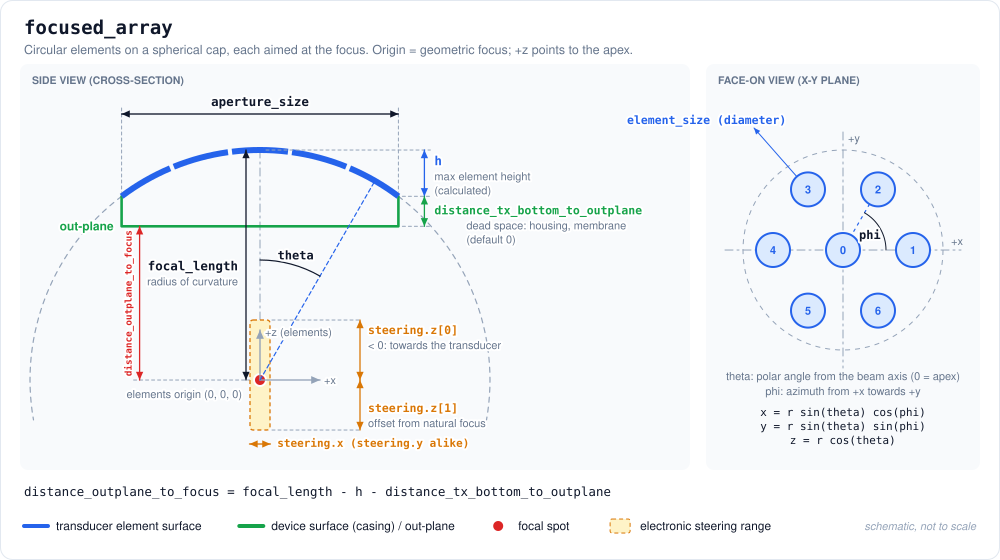

Example Transducer Yaml:
```yaml
# Template Version: 1.0
name: MyFocusedArray
geometry_type: focused_array
frequencies:
    - 500000
aperture_size: 0.064
focal_length: 0.070
num_elements: 7
element_size: 0.015
element_coordinate_system: spherical
elements:   # centre element plus a ring of six at 20 degrees
    r:     [0.070, 0.070, 0.070, 0.070, 0.070, 0.070, 0.070]
    theta: [0.0,   20.0,  20.0,  20.0,  20.0,  20.0,  20.0]
    phi:   [0.0,   0.0,   60.0,  120.0, 180.0, 240.0, 300.0]
steering:
    x: [-0.010, 0.010]
    y: [-0.010, 0.010]
    z: [-0.015, 0.015]
```

The same elements in cartesian coordinates:

```yaml
element_coordinate_system: cartesian
elements:
    x: [0.0,     0.02394, 0.01197, -0.01197, -0.02394, -0.01197,  0.01197]
    y: [0.0,     0.0,     0.02073,  0.02073,  0.0,     -0.02073, -0.02073]
    z: [0.070,   0.06578, 0.06578,  0.06578,  0.06578,  0.06578,  0.06578]
```

<br>Corresponding Plot:<br>
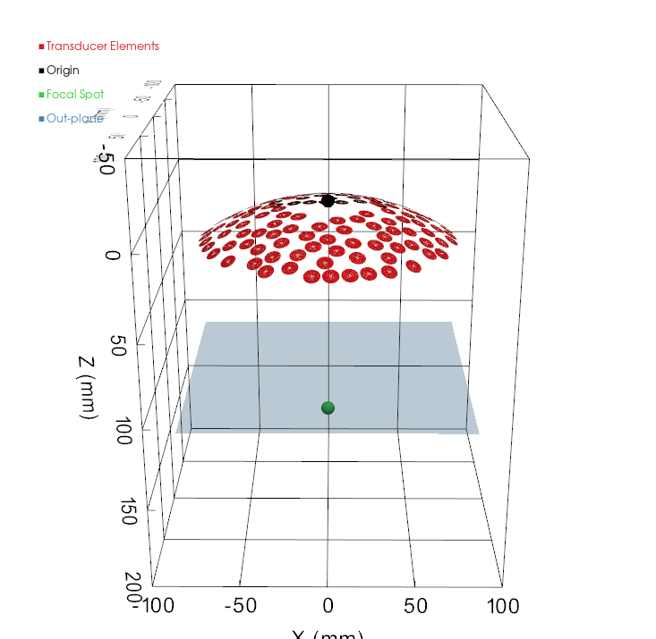
<!-- PLACEHOLDER: screenshot of the "focused array generated mesh plot" dialog -->

## Optional parameters
### PlanTUS

`PlanTUS` is optional and gives the PlanTUS integration focal distances and matching FHML (full-length at half maximum) values, in metres, for **every** frequency in `frequencies`. Both lists must be the same length and contain no negative values.

```yaml
PlanTUS:
    500000:
        FocalDistanceList: [0.030, 0.035, 0.040, 0.045, 0.050]
        FHMLList:          [0.018, 0.030, 0.038, 0.050, 0.060]
```

If `PlanTUS` is omitted, BabelBrain estimates the tables with Rayleigh simulations in water for each frequency (except for `flat_annular_array`):

- Steerable types are swept in 2 mm steps over the `steering.z` range (as absolute depths for flat types, or `focal_length + steering.z` for focused types).
- `simple_focused` uses a single point at `focal_length`.