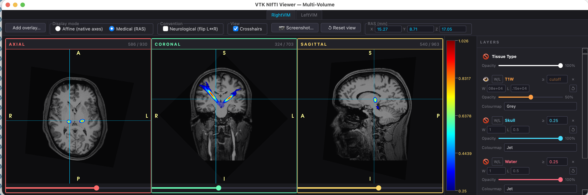
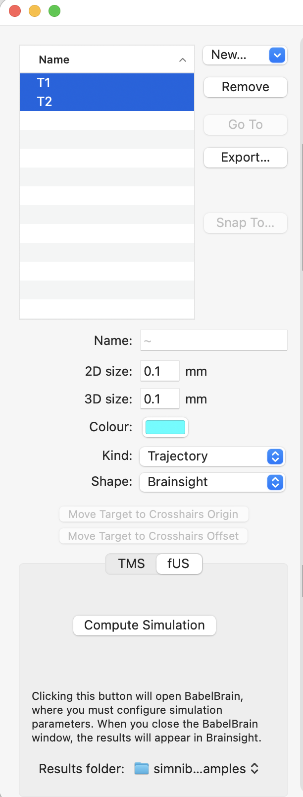
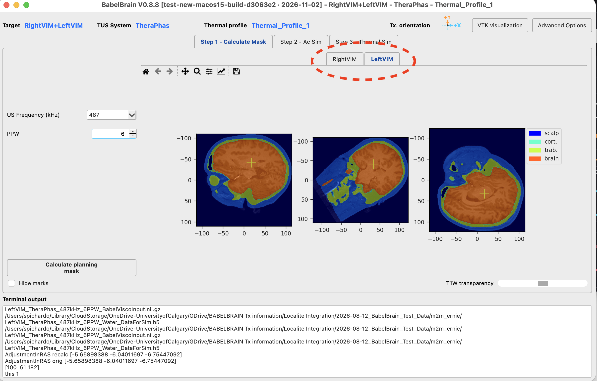
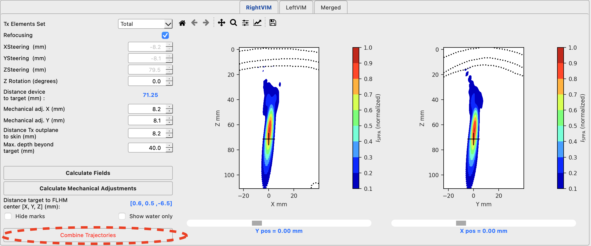
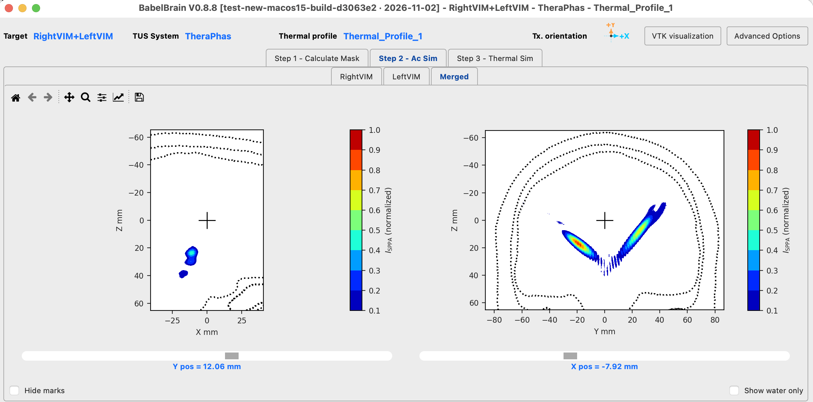
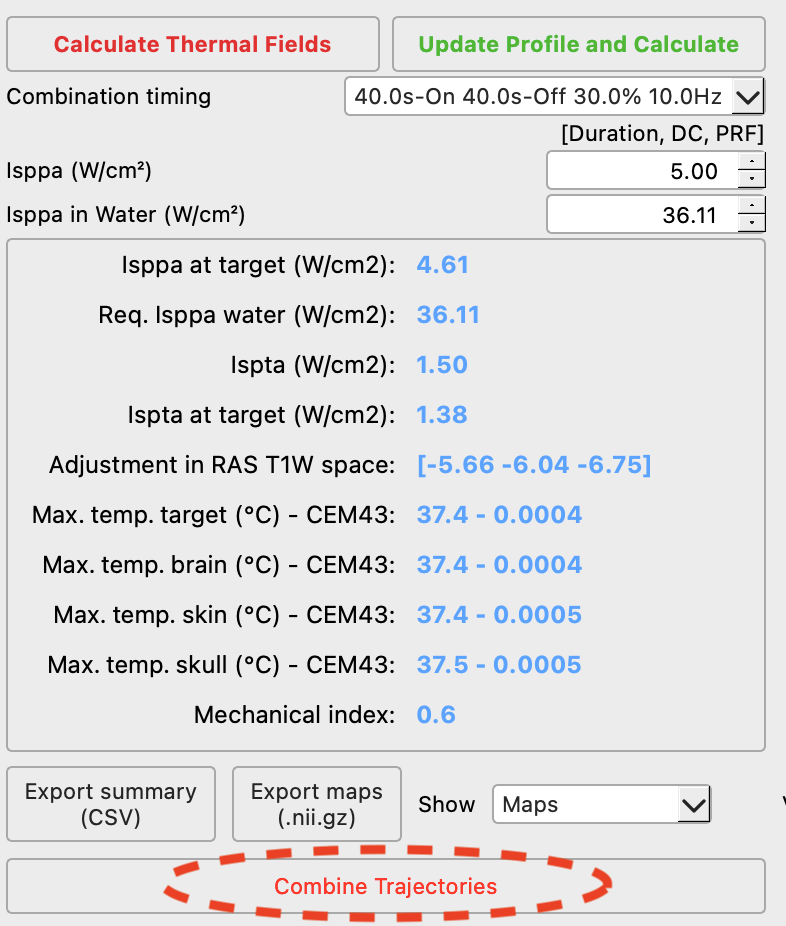
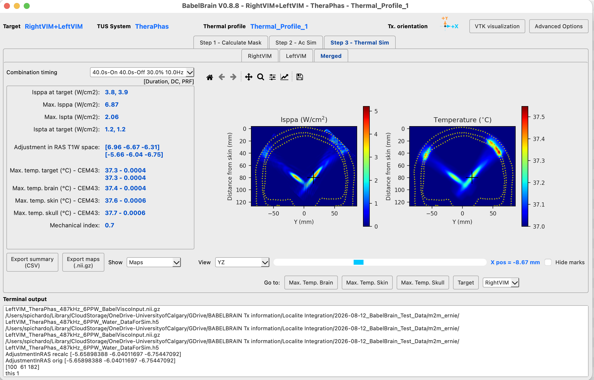

# Multiple trajectories / multiple devices

 

Multiple trajectories can be defined at the planning stage with Brainsight (v2.6 and up), Localite and 3DSlicer. **An important feature of this new mode is the capability to combine acoustic fields  of several trajectories to do planning of exposures with multiple devices turned on simultaneously**. 

For example in Brainsight, just select more than one target before calling BabelBrain. 

 

For 3DSlicer, there is no a native export format for multiple linear trasnformations, so the user must prepare manually a simple YAML file as the one below where paths to multiple linear transformations are indicated:

```YAML
T1: /Users/spichardo/Trajectories/T1.txt
T2: /Users/spichardo/Trajectories/T2.txt
```

Each dictionary string in the YAML file will be used as ID of each trajectory.

Im general, doing planning with multiple trajectories is not different from with individual, excepting BabelBrain now allows combining the results of the trajectories for simultaneous operation. Each trajectory appears now as individual tabs in each of Steps 1 to 3, as shown below in Step 1:

 


## Combination of acoustic fields - Step 2

In Step 2, once the individual simulations for each trajectory are completed, the "Combine Trajectories" buttons will be enabled:

 

 **Important**: Be sure of adjusting `Max. depth beyond target (mm)` field to extend the individual simulations to ensure the ultrasound beams from the different trajectories are correctly intersected.

After executing the combine action, the merged acoustic fields will be shown.

 

**Important**: The visualization of results at Step 2 assumes all trajectories have equal peak intensities. Individualized peak intensities are handled in Step 3.

Please note that the combination of acoustic fields is actually quite fast to perform, as acoustic fields are always saved with phase information, so there is no need of heavy calculations to combine them. Just be sure each individual trajectory is simulated with enough depth, so all beams are properly intersected.

## Combination of intensity and thermal fields - Step 3
Thermal simulations are performed in Step 3 by selecting the required intensities per trajectory. Once completed, the  "Combine trajectories" button will be enabled. 

 

 **SUPER IMPORTANT**: Before executing the combination of trajectories, be sure of adjusting to the desired intensities for each individual trajectory. Differently to the combinations of fields in step 2 (where it is assumed each field has the same peak intensity, and just for illustration purposes), in Step 3 each individual intensity field will be scaled to the selected intensity, and the thermal simulation will be fully executed for the volume enclosing all the trajectories, implying this action has a larger computational cost.  If adjustments are made to any of the intensities levels, it is **critical** to re-run the "Combine trajectories" action. The results of this action shows the combined intensity and thermal fields as shown below.

 

 The combined results are locked to the selected intensities selected for each of the individual trajectories.